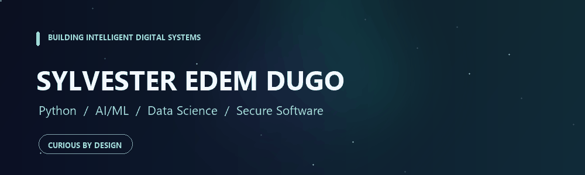

  

<h1 align="center">Sylvester Edem Dugo</h1>

  <strong>Python · AI/ML · Data Science · Software Engineering</strong> 
  Building intelligent, secure digital systems.

  <a href="https://github.com/SYLVESTEREDEM/zorlii_app">Currently building Zorlii — a small-community social app</a>

---

### About

I'm an IT practitioner focused on turning ideas into useful, reliable software. My interests span Python development, AI/ML, data science, and secure digital systems.

### Toolkit

`Python` · `FastAPI` · `AI/ML` · `Data Science` · `TypeScript` · `React Native` · `SQLite`

### Featured project

**[Zorlii](https://github.com/SYLVESTEREDEM/zorlii_app)** 
A small-community social app with an Expo mobile client and FastAPI backend.
